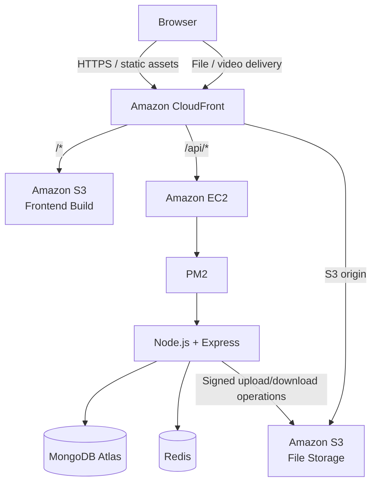
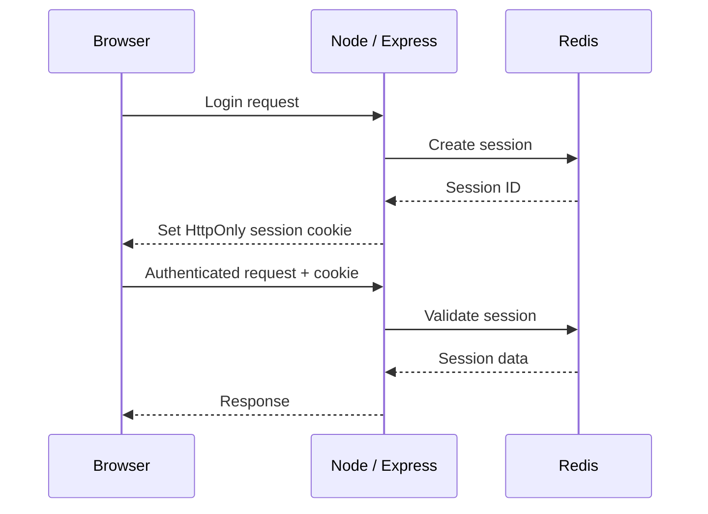
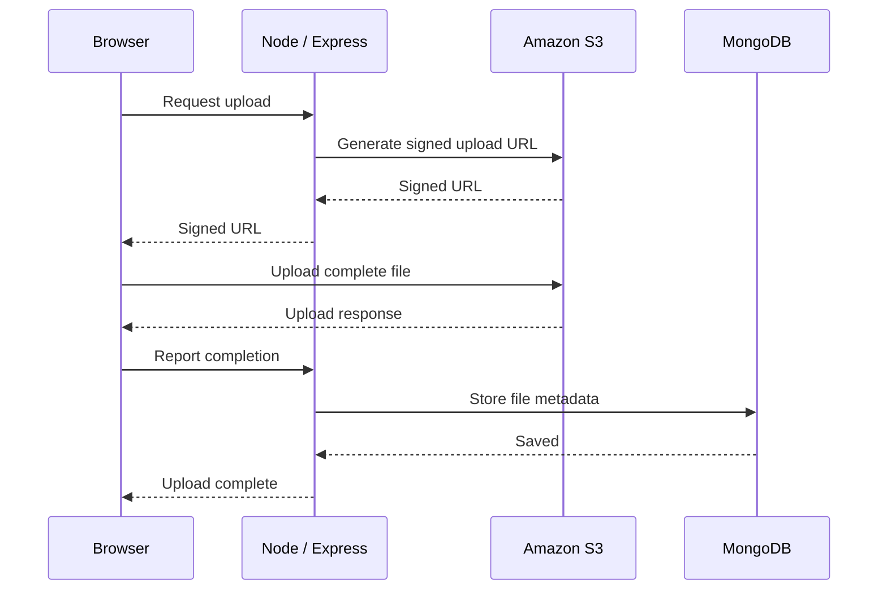
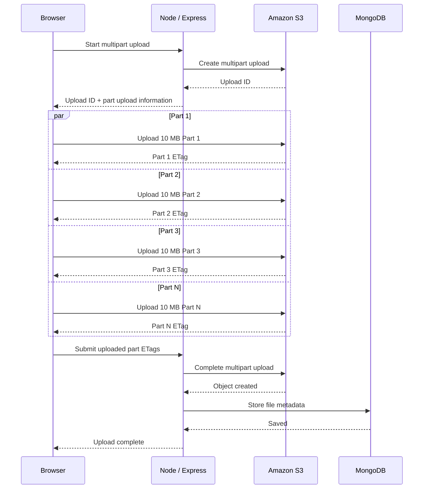
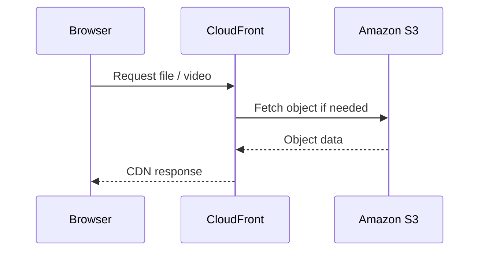

# Storiffy

A full-stack cloud storage platform for managing files and folders, with Redis-backed sessions, direct-to-S3 uploads, multipart uploads for large files, sharing, and CloudFront-based file/video delivery.

## Tech Stack

| Layer | Technologies |
|---|---|
| Frontend | React, TypeScript, React Router, Redux Toolkit, Tailwind CSS |
| Backend | Node.js, Express, TypeScript |
| Database | MongoDB Atlas, Mongoose |
| Session Store | Redis |
| Object Storage | Amazon S3 |
| CDN | Amazon CloudFront |
| Deployment | EC2, PM2, CloudFront, S3 |

## Application Architecture

The frontend is delivered through CloudFront from an S3 bucket. API requests use the same CloudFront entry point and are routed to the Node.js backend running on EC2. MongoDB stores application metadata, Redis stores server-side sessions, and S3 stores file objects. CloudFront delivers stored files and videos from S3.



### Component Responsibilities

| Component | Responsibility |
|---|---|
| React + TypeScript | UI, routing, client-side state, upload management |
| Node.js + Express | Authentication, authorization, file/folder APIs, sharing, upload orchestration |
| MongoDB Atlas | Users, files, directories, shares, and application metadata |
| Redis | Server-side sessions and session lifecycle management |
| Amazon S3 | Persistent object storage for uploaded files |
| Amazon CloudFront | HTTPS entry point, static frontend delivery, and CDN-based file/video delivery |
| EC2 + PM2 | Runs the Node.js backend |

## Authentication & Sessions

Storiffy uses server-side sessions stored in Redis. The browser receives an HttpOnly session cookie and sends it with authenticated API requests.



Session management also supports invalidating the current session and signing out all active sessions for a user.

## File Upload Architecture

Storiffy keeps file bytes out of the Node.js application server. The backend authorizes the operation and generates the required S3 upload information; the browser transfers the file directly to Amazon S3.

### Upload Strategy

- **Files up to 100 MB:** single-part upload.
- **Files greater than 100 MB:** multipart upload.
- Multipart uploads use **10 MB parts**.
- File bytes are transferred directly from the browser to S3 rather than through the Node.js server.

### Single-Part Upload



### Multipart Upload — Files > 100 MB

For files larger than 100 MB, the browser splits the file into **10 MB parts**. The backend creates the multipart upload and provides the information required for direct S3 part uploads. Each part is uploaded independently, allowing progress tracking and retrying an individual part without retransmitting the entire file.



### Why Multipart Upload

Multipart uploads allow large files to be transferred as independent parts. This reduces the impact of an individual part failure and allows the client to track and retry parts without restarting the entire upload.

## File & Video Delivery

Uploaded objects are stored in Amazon S3 and delivered through CloudFront instead of sending file bytes through the Node.js server.



The same S3 + CloudFront delivery path is used for video files, so large delivery traffic is handled by the CDN rather than the application server.

## Sharing

Storiffy supports sharing files and folders through share links with controlled access and expiration settings.

The backend validates access and retrieves the corresponding metadata/object information before allowing the shared resource to be accessed.

## Trash & Storage Management

Deleted files and folders are moved to trash instead of being immediately removed from the active hierarchy.

Supported operations include:

- Restore files and folders
- Permanently delete items
- Empty trash
- Multi-select trash operations
- Track storage usage as objects are added or removed

## Project Structure

```text
Storiffy/
├── client/                 # React + TypeScript frontend
│   ├── src/
│   └── dist/               # generated frontend build
│
├── server/                 # Node + Express backend
│   ├── src/
│   └── dist/               # compiled backend
│
├── generate-structure.js   # project structure utility
├── package.json            # root utility scripts
└── README.md
```

## Deployment

The deployed application separates static frontend delivery, API execution, database/session services, and object storage.

```text
Browser
   |
   v
CloudFront
   |
   +---- /* ------> S3 ------> React dist
   |
   +---- /api/* --> EC2 ------> PM2 ------> Node.js
                             |
                 +-----------+-----------+
                 |                       |
                 v                       v
          MongoDB Atlas                 Redis

File / video delivery
Browser ---> CloudFront ---> S3
```
